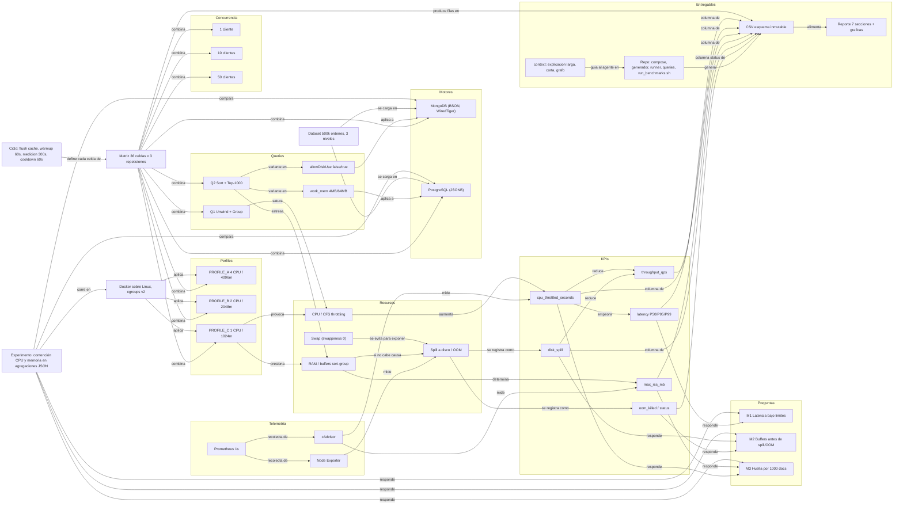

# Grafo de conocimiento del playbook

> **Aplicación:** el grafo representa el playbook general. En este experimento el nodo "Dataset 500k órdenes" corresponde a la colección `intentos` del proyecto **Lethics** (ver `03_requisitos_RF_RNF.md`, Anexo A). El resto de relaciones aplica sin cambios.

## Diagrama (Mermaid)

## Triples (sujeto, relación, objeto)

| # | Sujeto | Relación | Objeto |
|---|--------|----------|--------|
| 1 | Experimento | compara | MongoDB |
| 2 | Experimento | compara | PostgreSQL JSONB |
| 3 | Experimento | responde | M1, M2, M3 |
| 4 | Experimento | corre en | Docker sobre Linux (cgroups v2) |
| 5 | Dataset 500k | se carga en | MongoDB y PostgreSQL |
| 6 | Docker | aplica | Perfiles A, B, C |
| 7 | Perfil C | provoca | CFS throttling |
| 8 | Perfil C | presiona | RAM |
| 9 | Q1 | satura | CPU |
| 10 | Q2 | estresa | RAM (buffer de ordenamiento) |
| 11 | Q2 | tiene variante | allowDiskUse false/true (Mongo) |
| 12 | Q2 | tiene variante | work_mem 4MB/64MB (Postgres) |
| 13 | Swap (swappiness 0) | se evita para exponer | Spill / OOM |
| 14 | RAM insuficiente | causa | Spill a disco u OOM |
| 15 | CPU limitada | aumenta | cpu_throttled_seconds |
| 16 | Throttling | empeora | Latencia P95/P99 |
| 17 | Throttling | reduce | throughput_qps |
| 18 | Spill | reduce | throughput_qps |
| 19 | RAM | determina | max_rss_mb |
| 20 | cAdvisor | mide | Throttling y RSS |
| 21 | Node Exporter | mide | I/O, disco y swap del host |
| 22 | Prometheus (1 s) | recolecta de | cAdvisor y Node Exporter |
| 23 | Matriz | combina | 2 motores × 3 perfiles × 2 queries × 3 concurrencias |
| 24 | Ciclo (flush, warmup 60 s, medición 300 s, cooldown 60 s) | define cada celda de | Matriz |
| 25 | Matriz | produce filas en | CSV de esquema inmutable |
| 26 | CSV | alimenta | Reporte de 7 secciones y gráficas |
| 27 | Latencias P95/P99 | responden | M1 |
| 28 | Spill y OOM | responden | M2 |
| 29 | RSS y CPU por 1 000 docs | responden | M3 |
| 30 | Carpeta context | guía al agente en | Código del repositorio |

> Revisa que cada relación coincida con el playbook antes de usar este grafo como contexto del agente. Las relaciones 13 y 29 combinan lo que dice el playbook con interpretación razonable (ver ambigüedades en `00_explicacion_larga.md`).
